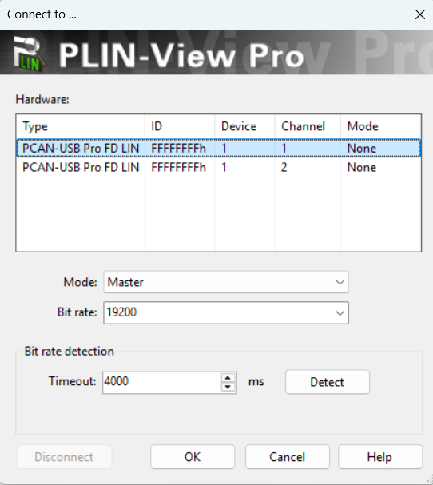
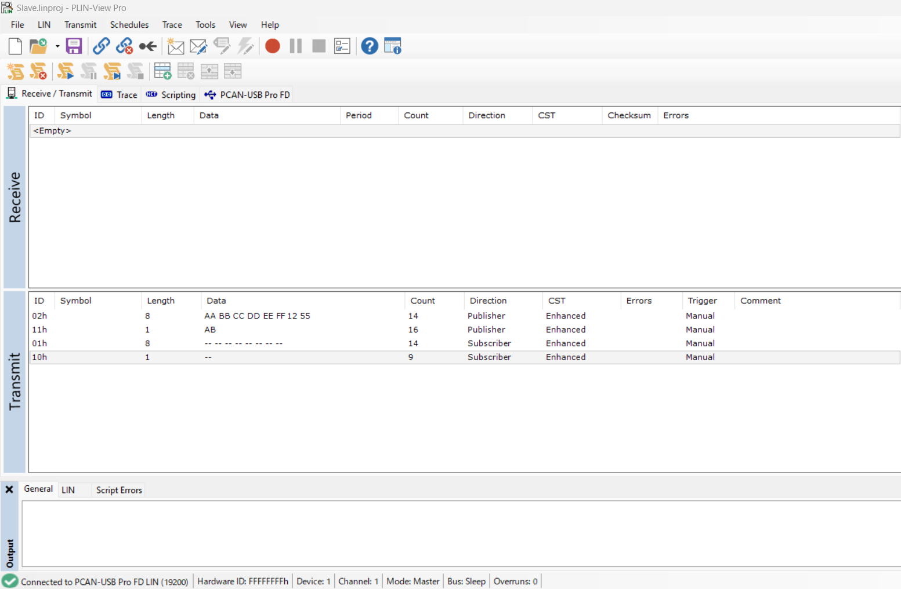
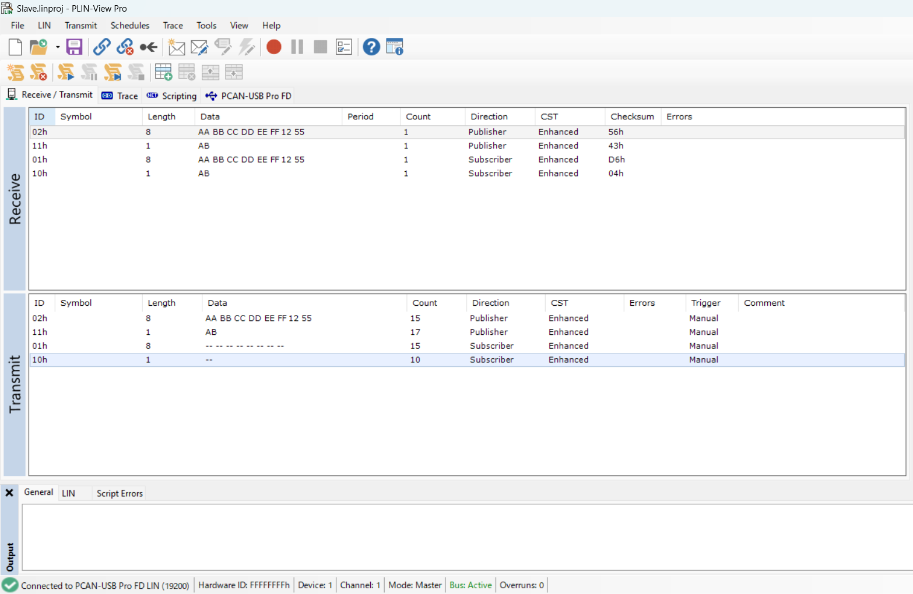
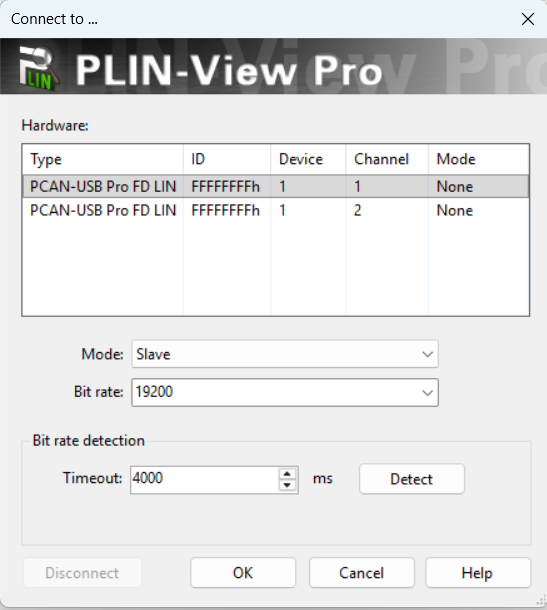
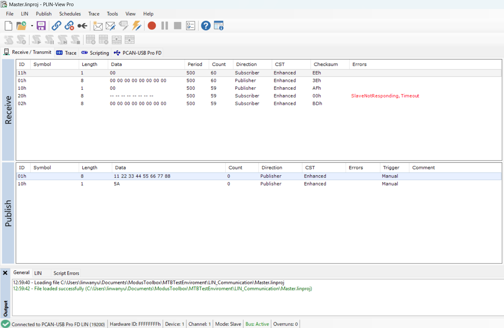
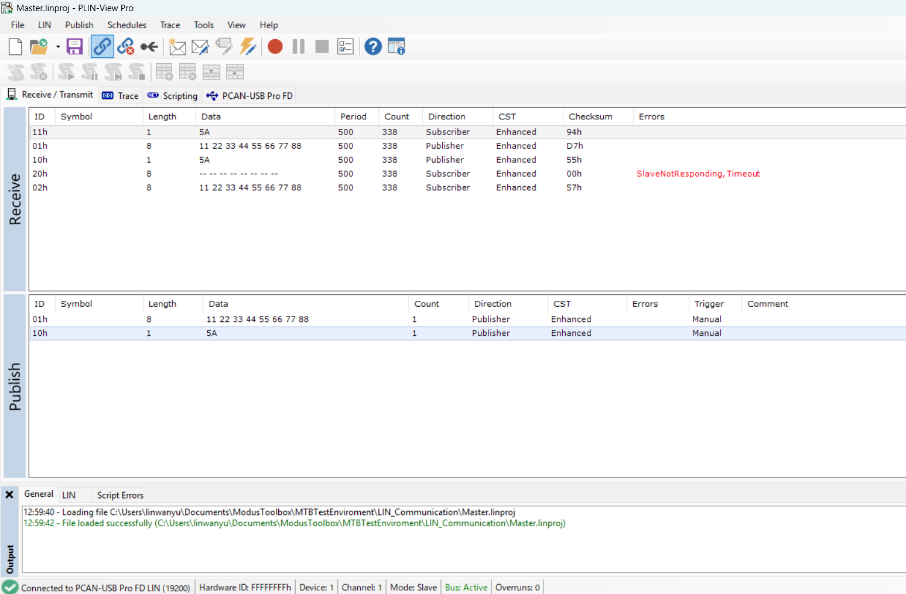

# LIN communication

This code example demonstrates how to configure and use the Local Interconnect Network (LIN) block of a TRAVEO&trade; T2G body entry MCU using the Peripheral Driver Library (PDL).

A single application source implements **both** LIN nodes of the example network. The node role is selected at compile time with the `LIN_MASTER_NODE` macro:

- **LIN master node** (`LIN_MASTER_NODE=1`) : runs a SysTick-based schedule and sends one LIN frame header per tick, providing or requesting the response depending on the frame.
- **LIN slave node** (`LIN_MASTER_NODE=0`, default) : receives frame headers and, depending on the frame ID, either transmits or receives the response.


[View this README on GitHub.](https://github.com/Infineon/mtb-example-ce243574-lin-communication)

[Provide feedback on this code example.](https://yourvoice.infineon.com/jfe/form/SV_1NTns53sK2yiljn?Q_EED=eyJVbmlxdWUgRG9jIElkIjoiQ0UyNDM1NzQiLCJTcGVjIE51bWJlciI6IjAwMi00MzU3NCIsIkRvYyBUaXRsZSI6IkxJTiBjb21tdW5pY2F0aW9uIiwicmlkIjoid2FueXUubGluQGluZmluZW9uLmNvbSIsIkRvYyB2ZXJzaW9uIjoiMS4wLjAiLCJEb2MgTGFuZ3VhZ2UiOiJFbmdsaXNoIiwiRG9jIERpdmlzaW9uIjoiTUNEIiwiRG9jIEJVIjoiQVVUTyIsIkRvYyBGYW1pbHkiOiJBVVRPIE1DVSJ9)

## Requirements

- [ModusToolbox&trade;](https://www.infineon.com/modustoolbox) v3.9 or later (tested with v3.9)
- Board support package (BSP) minimum required version: 3.0.0
- Programming language: C
- Associated parts: [TRAVEO&trade; T2G family body entry series](https://www.infineon.com/products/microcontroller/32-bit-traveo-t2g-arm-cortex/for-body)

## Supported toolchains (make variable 'TOOLCHAIN')

- GNU Arm&reg; Embedded Compiler v14.2.1 (`GCC_ARM`) - Default value of `TOOLCHAIN`
- Arm&reg; Compiler v6.22 (`ARM`)
- IAR C/C++ Compiler v9.70.2 (`IAR`)

## Supported kits (make variable 'TARGET')

- [TRAVEO&trade; T2G Body Entry 2GO Lite Kit](https://www.infineon.com/design-resources/finder-selection-tools/evaluation-board) (`KIT_T2G-B-E_2GO`) – Default value of `TARGET`


## Hardware setup

This example uses the board's default configuration. See the kit user guide to ensure that the board is configured correctly.

The LIN interface uses **LIN0 channel 4** routed to Port 7.

The following tables list the LIN port signals and LIN bus connections.

Signal | Pin
-------|------
LIN RX | P7.0
LIN TX | P7.1
LIN EN (transceiver enable) | P7.2

Signal | Pin
-------|------
VCC    | J14-1
LIN BUS| J14-2
GND    | J14-3

Connect the board's on-board LIN transceiver connector (LIN0) to the other LIN node, configured for 19.2 kbps. The counterpart can be:

- A second kit programmed with this example built in the opposite role (one board as master, one board as slave).
- An external LIN analyzer or interface that can take the opposite role.

   **Note:** In this code example, a **PCAN-USB Pro FD** interface running **PLIN-View Pro** is used as the counterpart node.

## Software setup

Install the [LIN Configurator](https://softwaretools.infineon.com/tools/com.ifx.tb.tool.linconfigurator) 2.0.0 for LIN Slave configuration.

Install the PC software corresponding to the LIN analyzer. In this code example, [PLIN-View Pro](https://www.peak-system.com/products/software/analysis-software/plin-view-pro/) is used.

See the [ModusToolbox&trade; tools package installation guide](https://www.infineon.com/ModusToolboxInstallguide) for information about installing and configuring the tools package.


## Using the code example

### Create the project

The ModusToolbox&trade; tools package provides the Project Creator as both a GUI tool and a command line tool.

<details><summary><b>Use Project Creator GUI</b></summary>

1. Open the Project Creator GUI tool

   There are several ways to do this, including launching it from the dashboard or from inside the Eclipse IDE. For more details, see the [Project Creator user guide](https://www.infineon.com/ModusToolboxProjectCreator) (locally available at *{ModusToolbox&trade; install directory}/tools_{version}/project-creator/docs/project-creator.pdf*).

2. On the **Choose Board Support Package (BSP)** page, select a kit supported by this code example. See [Supported kits](#supported-kits-make-variable-target)

   > **Note:** To use this code example for a kit not listed here, you may need to update the source files. If the kit does not have the required resources, the application may not work

3. On the **Select Application** page:

   a. Select the **Applications(s) Root Path** and the **Target IDE**

      > **Note:** Depending on how you open the Project Creator tool, these fields may be pre-selected for you

   b. Select this code example from the list by enabling its check box

      > **Note:** You can narrow the list of displayed examples by typing in the filter box

   c. (Optional) Change the suggested **New Application Name** and **New BSP Name**

   d. Click **Create** to complete the application creation process

</details>


<details><summary><b>Use Project Creator CLI</b></summary>

The 'project-creator-cli' tool can be used to create applications from a CLI terminal or from within batch files or shell scripts. This tool is available in the *{ModusToolbox&trade; install directory}/tools_{version}/project-creator/* directory.

Use a CLI terminal to invoke the 'project-creator-cli' tool. On Windows, use the command-line 'modus-shell' program provided in the ModusToolbox&trade; installation instead of a standard Windows command-line application. This shell provides access to all ModusToolbox&trade; tools. You can access it by typing "modus-shell" in the search box in the Windows menu. In Linux and macOS, you can use any terminal application.

The following example clones the "[mtb-example-ce243574-lin-communication](https://github.com/Infineon/mtb-example-ce243574-lin-communication)" application with the desired name "LIN Slave communication" configured for the [KIT_T2G-B-E_2GO](https://www.infineon.com/design-resources/finder-selection-tools/evaluation-board) BSP into the specified working directory, *C:/mtb_projects*:

   ```
   project-creator-cli --board-id KIT_T2G-B-E_2GO --app-id mtb-example-ce243574-lin-communication --user-app-name LIN communication --target-dir "C:/mtb_projects"
   ```

The 'project-creator-cli' tool has the following arguments:

Argument | Description | Required/optional
---------|-------------|-----------
`--board-id` | Defined in the <id> field of the [BSP](https://github.com/Infineon?q=bsp-manifest&type=&language=&sort=) manifest | Required
`--app-id`   | Defined in the <id> field of the [CE](https://github.com/Infineon?q=ce-manifest&type=&language=&sort=) manifest | Required
`--target-dir`| Specify the directory in which the application is to be created if you prefer not to use the default current working directory | Optional
`--user-app-name`| Specify the name of the application if you prefer to have a name other than the example's default name | Optional

> **Note:** The project-creator-cli tool uses the `git clone` and `make getlibs` commands to fetch the repository and import the required libraries. For details, see the "Project creator tools" section of the [ModusToolbox&trade; tools package user guide](https://www.infineon.com/ModusToolboxUserGuide) (locally available at {ModusToolbox&trade; install directory}/docs_{version}/mtb_user_guide.pdf).

</details>

### Open the project

After the project has been created, you can open it in your preferred development environment.

<details><summary><b>Eclipse IDE</b></summary>

If you opened the Project Creator tool from the included Eclipse IDE, the project will open in Eclipse automatically.

For more details, see the [Eclipse IDE for ModusToolbox&trade; user guide](https://www.infineon.com/MTBEclipseIDEUserGuide) (locally available at *{ModusToolbox&trade; install directory}/docs_{version}/mt_ide_user_guide.pdf*).

</details>

<details><summary><b>Visual Studio (VS) Code</b></summary>

Launch VS Code manually, and then open the generated *{project-name}.code-workspace* file located in the project directory.

For more details, see the [Visual Studio Code for ModusToolbox&trade; user guide](https://www.infineon.com/MTBVSCodeUserGuide) (locally available at *{ModusToolbox&trade; install directory}/docs_{version}/mt_vscode_user_guide.pdf*).

</details>

<details><summary><b>Keil µVision</b></summary>

Double-click the generated *{project-name}.cprj* file to launch the Keil µVision IDE.

For more details, see the [Keil µVision for ModusToolbox&trade; user guide](https://www.infineon.com/MTBuVisionUserGuide) (locally available at *{ModusToolbox&trade; install directory}/docs_{version}/mt_uvision_user_guide.pdf*).

</details>

<details><summary><b>IAR Embedded Workbench</b></summary>

Open IAR Embedded Workbench manually, and create a new project. Then select the generated *{project-name}.ipcf* file located in the project directory.

For more details, see the [IAR Embedded Workbench for ModusToolbox&trade; user guide](https://www.infineon.com/MTBIARUserGuide) (locally available at *{ModusToolbox&trade; install directory}/docs_{version}/mt_iar_user_guide.pdf*).

</details>

<details><summary><b>Command line</b></summary>

If you prefer to use the CLI, open the appropriate terminal, and navigate to the project directory. On Windows, use the command-line 'modus-shell' program; on Linux and macOS, you can use any terminal application. From there, you can run various `make` commands.

For more details, see the [ModusToolbox&trade; tools package user guide](https://www.infineon.com/ModusToolboxUserGuide) (locally available at *{ModusToolbox&trade; install directory}/docs_{version}/mtb_user_guide.pdf*).
</details>

### Operation

1. Connect the board to your PC using the provided USB cable through the KitProg3 USB connector.

2. Connect the board's LIN0 bus (P7.0/P7.1 through the on-board transceiver) to the **PCAN-USB Pro FD** to your PC.

3. Select the node role as described above.

4. Program the board using one of the following:

   <details><summary><b>Using Eclipse IDE</b></summary>

      a. Select the application project in the Project Explorer

      b. In the **Quick Panel**, scroll down, and click **\<Application Name> Program (KitProg3_MiniProg4)**
   </details>


   <details><summary><b>In other IDEs</b></summary>

   Follow the instructions in your preferred IDE

   </details>


   <details><summary><b>Using CLI</b></summary>

     From the terminal, execute the `make program` command to build and program the application using the default toolchain to the default target. The default toolchain is specified in the application's Makefile but you can override this value manually:
      ```
      make program TOOLCHAIN=<toolchain>
      ```

      Example:
      ```
      make program TOOLCHAIN=GCC_ARM
      ```
   </details>

5. After programming, the application starts automatically.

6. Open **PLIN-View Pro** and connect to **PCAN-USB Pro FD**. Click the **LIN** tab, then click **Connect** to open the settings. Select the connected hardware channel. Set **Bit rate** to **19200 bps**, then select the PLIN mode opposite to the CE role and click **OK**:

   - CE built with `LIN_MASTER_NODE=0` (CE is the LIN slave): set PLIN-View Pro to **Master**. See step 6-1.
   - CE built with `LIN_MASTER_NODE=1` (CE is the LIN master): set PLIN-View Pro to **Slave**. See step 6-2.

   A LIN bus must have exactly one master. Do not configure both the CE and PLIN-View Pro as Master, or both as Slave.

   The example network uses the following frames:

   Frame ID | Direction | Length | Behavior
   ---------|-----------|--------|---------
   0x01 | Slave &rarr; Master | 8 bytes | Slave transmits its response, master receives it
   0x02 | Master &rarr; Slave | 8 bytes | Master transmits its response, slave receives and stores the data
   0x10 | Slave &rarr; Master | 1 byte | Slave transmits its response, master receives it
   0x11 | Master &rarr; Slave | 1 byte | Master transmits its response, slave receives and stores the data
   0x20 | Other node | 8 bytes | Master sends the header only; this slave ignores the ID

   This table describes the LIN network and therefore applies to **both** configurations. **Master** and **Slave** refer to the LIN bus roles, not to a fixed node: depending on `LIN_MASTER_NODE`, the master is either the CE or PLIN-View Pro, and the other node is the slave. The frame IDs, directions, and lengths are identical in both cases. The only exception is ID 0x20, which is sent only by the CE when it is built as the master.

   **Note:** A slave node never starts a transfer on its own; it can only fill in the response field of a header that the master has sent. Therefore, sending ID 0x02 does **not** make the slave answer with ID 0x01 by itself &ndash; the master must send the ID 0x01 header separately to fetch the data back.

   **6-1. CE as the LIN slave (default) &ndash; PLIN-View Pro as the master**

   Set PLIN-View Pro to **Master** mode.

   **Figure 1. PLIN-View Pro (Master) connection settings**

   

   Set the frame length and checksum type of every used ID so that they match the CE message table: ID 0x01 and 0x02 are **8 bytes**, ID 0x10 and 0x11 are **1 byte**, all with **enhanced (extended) checksum**. A length mismatch is reported by the CE as a bus error.

   As the master, PLIN-View Pro publishes the master-to-slave frames ID 0x02 and 0x11 from the **Transmit** list. The slave-to-master frames ID 0x01 and 0x10 are sent as a header only; their data field is filled in by the CE slave.

   **Figure 2. Transmit frame**

   

   Transmit the data and check the data on Receive in PLIN-View Pro.

   **Figure 3. Receive frame**

   

   **Summary of the transmit and receive actions:** PLIN-View Pro is the master and drives every transfer. Transmitting ID 0x02 (8 bytes) or ID 0x11 (1 byte) sends the payload to the CE slave, which stores it. Transmitting ID 0x01 (8 bytes) or ID 0x10 (1 byte) sends only the header, and the CE slave fills in the response with the data that was written before &ndash; the echoed value then shows up in the **Receive** list. In other words, 0x02 and 0x11 write to the slave, while 0x01 and 0x10 read the data back.

   A ready-to-use PLIN-View Pro project with these settings is provided as `Slave.linproj`.

   **6-2. CE as the LIN master &ndash; PLIN-View Pro as the slave**

   Set PLIN-View Pro to **Slave** mode.

   **Figure 4. PLIN-View Pro (Slave) connection settings**

   

   PLIN-View Pro only has to publish the responses for the slave-to-master frames ID 0x01 (8 bytes) and ID 0x10 (1 byte); the master-to-slave frames ID 0x02 and 0x11 are received automatically.

   Enter the response data for ID 0x01 and ID 0x10 in the **Transmit** list.

   Note that the **Transmit** list behaves differently in the two PLIN modes. In master mode (step 6-1), sending a frame puts it on the bus right away. In slave mode, nothing is sent at that moment: the data is only stored in the hardware as the response for that frame ID. It stays there until the CE master sends the matching header, and only then does the LIN hardware insert it into the response field of that frame. If the CE never requests the ID, the data never appears on the bus.

   **Figure 5. Response data entered in the Publish list**

   

   The entries in the **Publish** list use a **Manual** trigger, so the data is handed to the LIN hardware only after it is sent once. Until then the CE master still receives the previous content, which is why ID 0x01 and 0x02 read all zeros in Figure 5 even though the schedule is already running.

   **Figure 6. Received frames showing the echoed data**

   

   **Summary of the transmit and receive actions:** the CE master drives every transfer, so the data entered in PLIN-View Pro travels in a loop. The CE requests ID 0x01 and 0x10, stores the response it gets, and sends that same data back on the paired frame ID 0x02 and 0x11. The round trip is therefore:

   PLIN **Transmit** ID 0x01 &rarr; CE reads it &rarr; CE sends it back &rarr; PLIN **Receive** ID 0x02

   PLIN **Transmit** ID 0x10 &rarr; CE reads it &rarr; CE sends it back &rarr; PLIN **Receive** ID 0x11

   For example, if ID 0x01 is filled with `11 22 33 44 55 66 77 88`, the same eight bytes show up in the **Receive** list on ID 0x02 one frame later. Changing the transmit data changes the received data on the next round, which confirms that the link works in both directions.

   **Note:** ID 0x20 is defined as a frame whose response is provided by a *third* node on the bus. On a two-node setup (CE plus PLIN-View Pro) nobody answers this header, so PLIN-View Pro reports ID 0x20 with a **slave not responding** error once per schedule round. This is expected and does not indicate a fault &ndash; the CE sends the header only and never waits for the response. To suppress the message, configure PLIN-View Pro to publish a response for ID 0x20 as well.

   A ready-to-use PLIN-View Pro project with these settings is provided as `Master.linproj`.

7. Observe the echo behavior on the LIN analyzer.

   In both roles, the CE copies a received response into the transmit buffer of the paired frame, so every value that appears on the bus is echoed back one frame later. Which frame carries the echo depends on the role.

   **CE as the slave (step 6-1):** the received frame is copied to the *preceding* message-table entry, that is `0x02` to `0x01` and `0x11` to `0x10`. With the schedule `0x02` &rarr; `0x01` &rarr; `0x11` &rarr; `0x10`, one pass looks like this:

   1. Header 0x02 &ndash; the master sends 8 bytes; the slave stores them and copies them into the ID 0x01 transmit buffer.
   2. Header 0x01 &ndash; the slave answers with exactly those 8 bytes.
   3. Header 0x11 &ndash; the master sends 1 byte; the slave copies it into the ID 0x10 transmit buffer.
   4. Header 0x10 &ndash; the slave answers with that byte.

   **CE as the master (step 6-2):** the direction is reversed. A received slave response is stored in the *following* schedule entry, that is `0x01` to `0x02` and `0x10` to `0x11`. The CE sends one header per SysTick tick, so one pass through its five-entry schedule looks like this:

   1. Header 0x01 &ndash; the slave answers with 8 bytes; the master stores them in the ID 0x02 transmit buffer.
   2. Header 0x02 &ndash; the master sends those 8 bytes back to the slave.
   3. Header 0x10 &ndash; the slave answers with 1 byte; the master stores it in the ID 0x11 transmit buffer.
   4. Header 0x11 &ndash; the master sends that byte back to the slave.
   5. Header 0x20 &ndash; header only; the CE does not provide a response.

   Because the copy happens as soon as the response is received, the echoed value is always the most recent one. Headers with an unknown ID are ignored by the CE slave. Observe the bus traffic on the LIN analyzer, or inspect the `msgContext` array with the debugger.


## Debugging

You can debug the example to step through the code.

<details><summary><b>In Eclipse IDE</b></summary>

Use the **\<Application Name> Debug (KitProg3_MiniProg4)** configuration in the **Quick Panel**. For details, see the "Program and debug" section in the [Eclipse IDE for ModusToolbox&trade; user guide](https://www.infineon.com/MTBEclipseIDEUserGuide).

</details>

<details><summary><b>In other IDEs</b></summary>

Follow the instructions in your preferred IDE.
</details>
<br>

## Design and implementation

The LIN block is configured entirely in firmware using the PDL (`cy_lin`), because the LIN signals on this kit are available only on Port 7 / LIN0 channel 4. On startup, `main()`:

1. Initializes the device and board (`cybsp_init()`).
2. Configures the LIN peripheral clock divider for a 19.2 kbps bit rate (LIN input clock / 16 oversampling = 80 MHz / 260 / 16 = 19231 baud).
3. Initializes the LIN pins P7.0/P7.1/P7.2 with their LIN HSIOM functions (RX4/TX4/EN4).
4. Initializes the LIN channel (`Cy_LIN_Init()`) as master or slave and registers the interrupt handler.
5. Master only: initializes SysTick and starts the schedule (`SchedulerInit()`). Slave only: starts header reception.

All LIN protocol handling runs in the interrupt handler as a small state machine:

- **Master:** `TX_HEADER` / `TX_HEADER_TX_RESPONSE` / `TX_HEADER_RX_RESPONSE` &rarr; `IDLE`, waiting for the next schedule tick. A bus error resets the channel and returns to `IDLE`.
- **Slave:** `RX_HEADER` &rarr; `TX_RESPONSE` / `RX_RESPONSE` &rarr; back to `RX_HEADER`. A bus error resets the channel and returns to header reception.

The master-specific and slave-specific code (configuration structure, state enumeration, message table, schedule handler, and interrupt handler) is separated with `#if (LIN_MASTER_NODE)` / `#else` / `#endif` blocks, so both nodes share one source file.

### Resources and settings

**Table 1. Application resources**

Resource | Alias/object | Purpose
---------|--------------|--------
LIN (PDL) | LIN0 channel 4 | LIN master or slave node communication
GPIO (PDL) | P7.0 / P7.1 / P7.2 | LIN RX / TX / EN
SysTick (PDL) | Cortex&reg;-M4 SysTick | Master schedule timebase (master role only)

## Related resources

Resources | Links
----------|------
Application notes | [AN235305](https://www.infineon.com/assets/row/public/documents/10/42/infineon-an235305-getting-started-with-traveo-t2g-family-mcus-in-modustoolbox-applicationnotes-en.pdf) – Getting started with TRAVEO&trade; T2G family MCUs in ModusToolbox&trade; software
Code examples | [Using ModusToolbox&trade;](https://github.com/Infineon/Code-Examples-for-ModusToolbox-Software) on GitHub
Device documentation | [TRAVEO&trade; T2G body entry family MCUs datasheets for CYT2B7](https://www.infineon.com/products/microcontroller/32-bit-traveo-t2g-arm-cortex/for-body/t2g-cyt2b7#documents) <br> [TRAVEO&trade; T2G body entry family MCUs architecture/registers reference manuals for CYT2B7](C:\Users\linwanyu\Documents\ModusToolbox\MTBTestEnviroment\LIN_Communication\lin_communication) 
Development kits | Select your kits from the [Evaluation board finder](https://www.infineon.com/cms/en/design-support/finder-selection-tools/product-finder/evaluation-board) page
Libraries on GitHub | [mtb-pdl-cat1](https://github.com/Infineon/mtb-pdl-cat1) – Peripheral Driver Library (PDL)
Tools | [ModusToolbox&trade;](https://www.infineon.com/modustoolbox) – ModusToolbox&trade; software is a collection of easy-to-use libraries and tools enabling rapid development with Infineon MCUs.

<br>

## Other resources

Infineon provides a wealth of data at [www.infineon.com](https://www.infineon.com) to help you select the right device, and quickly and effectively integrate it into your design.


## Document history

Document title: *CE243574 - LIN communication*

 | Version | Description of change |
 | ------- | --------------------- |
 | 1.0.0   | New code example      |

<br>

All referenced product or service names and trademarks are the property of their respective owners.

The Bluetooth® word mark and logos are registered trademarks owned by Bluetooth SIG, Inc., and any use of such marks by Infineon is under license.

PSOC™, formerly known as PSoC™, is a trademark of Infineon Technologies. Any references to PSoC™ in this document or others shall be deemed to refer to PSOC™.

---------------------------------------------------------
(c) 2021-2026, Infineon Technologies AG, or an affiliate of Infineon Technologies AG. All rights reserved.
This software, associated documentation and materials ("Software") is owned by Infineon Technologies AG or one of its affiliates ("Infineon") and is protected by and subject to worldwide patent protection, worldwide copyright laws, and international treaty provisions. Therefore, you may use this Software only as provided in the license agreement accompanying the software package from which you obtained this Software. If no license agreement applies, then any use, reproduction, modification, translation, or compilation of this Software is prohibited without the express written permission of Infineon.
<br>
Disclaimer: UNLESS OTHERWISE EXPRESSLY AGREED WITH INFINEON, THIS SOFTWARE IS PROVIDED AS-IS, WITH NO WARRANTY OF ANY KIND, EXPRESS OR IMPLIED, INCLUDING, BUT NOT LIMITED TO, ALL WARRANTIES OF NON-INFRINGEMENT OF THIRD-PARTY RIGHTS AND IMPLIED WARRANTIES SUCH AS WARRANTIES OF FITNESS FOR A SPECIFIC USE/PURPOSE OR MERCHANTABILITY. Infineon reserves the right to make changes to the Software without notice. You are responsible for properly designing, programming, and testing the functionality and safety of your intended application of the Software, as well as complying with any legal requirements related to its use. Infineon does not guarantee that the Software will be free from intrusion, data theft or loss, or other breaches (“Security Breaches”), and Infineon shall have no liability arising out of any Security Breaches. Unless otherwise explicitly approved by Infineon, the Software may not be used in any application where a failure of the Product or any consequences of the use thereof can reasonably be expected to result in personal injury.
